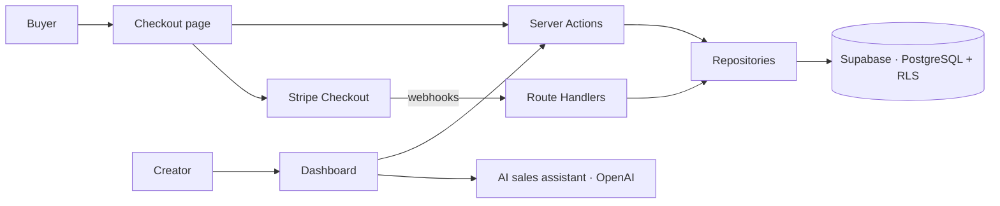

<h1 align="center">Velto Pay</h1>

<p align="center">
  Smart checkout platform for digital product creators.<br>
  Checkout, payments, orders, finance and AI sales assistant in one SaaS.
</p>

<p align="center">
  
  
  
  
  
</p>

---

> **Status:** no longer in active development. The landing page is still live: [velto-pay.vercel.app](https://velto-pay.vercel.app)

## Overview

Velto Pay is a Brazilian SaaS platform for digital creators to sell products through their own checkout. It brings sales operations, payments, orders and finance together in a single premium experience, built on Next.js and Supabase with an architecture ready for multiple payment gateways.

## Features

- **Products** — create and manage digital products and offers.
- **Checkout** — branded checkout pages for each product.
- **Payments** — Stripe Checkout integration with webhook handling (test mode).
- **Orders** — order tracking, refunds and disputes.
- **Dashboard** — sales overview for creators.
- **Finance** — revenue and financial reports.
- **AI sales assistant** — OpenAI-powered commercial insights.

## Tech stack

| Area | Tools |
|---|---|
| Framework | Next.js 15 (App Router), TypeScript strict |
| UI | Tailwind CSS, shadcn/ui |
| Backend | Supabase Auth, Database and Row Level Security |
| Database | PostgreSQL with versioned migrations |
| Forms & data | React Hook Form, Zod, TanStack Query |
| Payments | Stripe Checkout |
| AI | OpenAI API |
| Testing | Vitest |
| Deploy | Vercel |

## Architecture



Organized by modules in `src/modules`: `auth`, `products`, `checkout`, `orders`, `payments`, `dashboard`, `finance`.

- Each module separates **domain, application, infrastructure and presentation**.
- Data access lives in **server-only repositories**.
- Internal mutations use **Server Actions**.
- Payment webhooks use **Route Handlers** on the Node runtime.
- Payment layer is **gateway-agnostic**, prepared for multiple providers.

More in [ARCHITECTURE.md](./ARCHITECTURE.md), [docs/architecture.md](./docs/architecture.md), [docs/payments.md](./docs/payments.md) and [docs/database.md](./docs/database.md).

## Running locally

```bash
corepack enable
corepack pnpm install
cp .env.example .env.local
corepack pnpm dev
```

Runs at `http://localhost:3000`. Fill `.env.local` using `.env.example` as reference.

<details>
<summary><b>Supabase and Stripe setup</b></summary>

```bash
# Supabase
corepack pnpm supabase:start
corepack pnpm supabase:db:reset
corepack pnpm supabase:gen-types

# Stripe webhooks (test mode)
stripe listen --forward-to localhost:3000/api/payments/webhooks/stripe
```

Test cards: `4242 4242 4242 4242` (approved), `4000 0000 0000 0002` (declined).

</details>

## Quality

```bash
corepack pnpm lint
corepack pnpm test
corepack pnpm typecheck
corepack pnpm build
```

---

<p align="center">Built by <a href="https://github.com/vitoramorimt">Vitor Amorim (vaT)</a></p>
